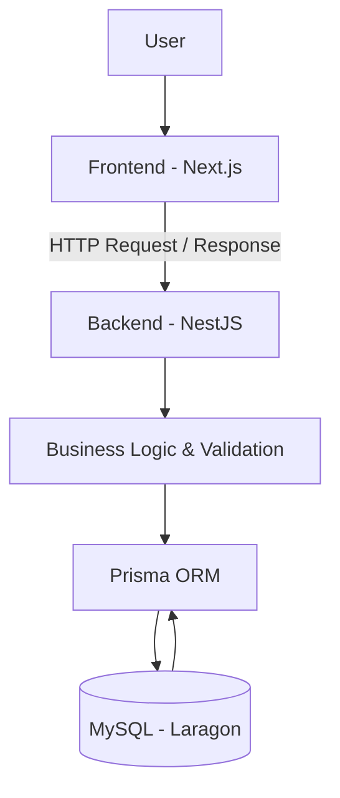
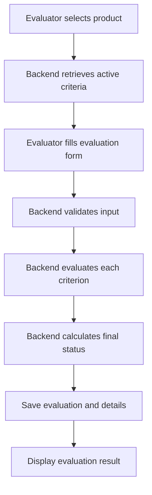
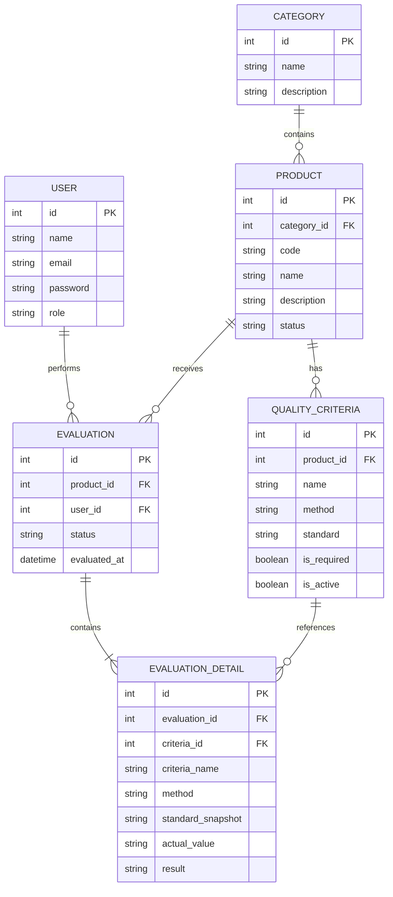

# System Architecture

**Project:** Sistem Manajemen Kualitas Produk  
**Version:** 0.2
**Status:** Draft

## 1. Overview

Sistem Manajemen Kualitas Produk menggunakan arsitektur **Client-Server** dengan pendekatan **Monolithic Backend**.

Aplikasi terdiri dari tiga bagian utama:

1. **Frontend:** Menampilkan antarmuka dan menangani interaksi pengguna.
2. **Backend:** Menangani autentikasi, validasi, business logic, dan komunikasi dengan database.
3. **Database:** Menyimpan data pengguna, produk, kategori, kriteria kualitas, dan hasil evaluasi.

Frontend dan backend berkomunikasi melalui REST API. Frontend tidak diperbolehkan mengakses database secara langsung.

## 2. Technology Stack

| Layer | Technology |
|---|---|
| Frontend | Next.js |
| Language | TypeScript |
| Styling | Tailwind CSS |
| Backend | NestJS |
| API | REST API |
| ORM | Prisma |
| Database | MySQL |
| Local Development Environment | Laragon |
| Version Control | Git & GitHub |

## 3. High-Level Architecture



### Component Responsibilities

**Frontend — Next.js**
- Menampilkan halaman dashboard.
- Menampilkan dan mengelola data produk.
- Menampilkan kategori dan kriteria kualitas.
- Menyediakan formulir evaluasi.
- Menampilkan hasil evaluasi.
- Mengirim request ke backend melalui REST API.

**Backend — NestJS**
- Mengelola autentikasi dan otorisasi.
- Menyediakan endpoint REST API.
- Memvalidasi request.
- Menjalankan business logic.
- Menghitung status setiap kriteria.
- Menghitung status akhir evaluasi.
- Mengelola transaksi database.

**Database — MySQL**
- Menyimpan data pengguna.
- Menyimpan kategori dan produk.
- Menyimpan kriteria kualitas.
- Menyimpan evaluasi dan detail hasil evaluasi.

## 4. Backend Module Structure

Backend menggunakan pendekatan modular berdasarkan domain bisnis.

| Module | Responsibility |
|---|---|
| Auth | Autentikasi dan otorisasi pengguna |
| Users | Pengelolaan pengguna |
| Categories | Pengelolaan kategori produk |
| Products | Pengelolaan data produk |
| Quality Criteria | Pengelolaan kriteria kualitas |
| Evaluations | Proses evaluasi kualitas produk |
| Dashboard | Penyediaan ringkasan data |
| Reports | Penyediaan laporan evaluasi |

Setiap module memiliki tanggung jawab yang terpisah agar kode lebih mudah dikembangkan dan dipelihara.

## 5. Evaluation Architecture

Proses evaluasi dilakukan di backend sebagai sumber utama perhitungan hasil.

### 5.1 Evaluation Methods

Sistem mendukung tiga metode evaluasi:

**A. Rating 1–5**

Evaluator memberikan nilai antara 1 sampai 5.

Status kriteria:
- PASS jika nilai aktual memenuhi atau melebihi nilai minimum.
- FAIL jika nilai aktual di bawah nilai minimum.

**B. Numeric**

Evaluator memasukkan nilai numerik.

Kriteria dapat menggunakan:
- Minimum value.
- Maximum value.
- Range value.

Status PASS diberikan jika nilai aktual memenuhi standar yang telah dikonfigurasi.

**C. Pass/Fail**

Evaluator memilih salah satu status:
- PASS
- FAIL

### 5.2 Final Evaluation Status

Backend menentukan hasil akhir berdasarkan seluruh kriteria wajib.

| Condition | Final Status |
|---|---|
| Masih ada kriteria wajib yang belum diisi | INCOMPLETE |
| Semua kriteria wajib selesai dan ada yang FAIL | FAIL |
| Semua kriteria wajib selesai dan seluruhnya PASS | PASS |

Kriteria opsional tidak memengaruhi status akhir evaluasi.

Nilai rata-rata rating hanya digunakan sebagai informasi tambahan, bukan penentu kelulusan.

### 5.3 Evaluation Flow



## 6. Database Architecture

Database menggunakan MySQL sebagai sistem manajemen basis data relasional. Prisma digunakan sebagai ORM untuk mengelola komunikasi antara backend dan database.

### Main Entities

| Entity | Description |
|---|---|
| User | Menyimpan informasi pengguna |
| Category | Menyimpan kategori produk |
| Product | Menyimpan informasi produk |
| QualityCriteria | Menyimpan standar penilaian kualitas |
| Evaluation | Menyimpan data utama evaluasi |
| EvaluationDetail | Menyimpan hasil setiap kriteria dalam evaluasi |

### Entity Relationships



**Catatan:** ERD merupakan rancangan awal. Tipe data, constraint, dan relasi final akan disesuaikan saat implementasi Prisma Schema.

### Historical Data

EvaluationDetail menyimpan snapshot informasi kriteria saat evaluasi dilakukan.

Tujuannya:
- Perubahan nama kriteria tidak mengubah riwayat evaluasi.
- Perubahan standar tidak mengubah hasil evaluasi sebelumnya.
- Riwayat evaluasi tetap dapat ditampilkan meskipun kriteria master berubah.

## 7. Project Directory Structure

Struktur repository menggunakan monorepo sederhana dengan frontend dan backend terpisah.

```text
sistem-manajemen-kualitas/
│
├── frontend/
│   ├── src/
│   │   ├── app/
│   │   ├── components/
│   │   ├── services/
│   │   ├── hooks/
│   │   ├── types/
│   │   └── lib/
│   ├── public/
│   ├── package.json
│   └── .env.example
│
├── backend/
│   ├── src/
│   │   ├── auth/
│   │   ├── users/
│   │   ├── categories/
│   │   ├── products/
│   │   ├── quality-criteria/
│   │   ├── evaluations/
│   │   ├── dashboard/
│   │   ├── reports/
│   │   └── main.ts
│   ├── prisma/
│   │   └── schema.prisma
│   ├── package.json
│   └── .env.example
│
├── docs/
│   ├── prd.md
│   ├── architecture.md
│   └── design-system.md
│
├── agents.md
├── README.md
└── .gitignore
```

Struktur dapat berkembang sesuai kebutuhan implementasi.

## 8. Environment Configuration

Konfigurasi koneksi database dan secret disimpan melalui environment variables.

**Frontend**
- `NEXT_PUBLIC_API_URL`

**Backend**
- `DATABASE_URL`
- `JWT_SECRET`
- `PORT`

Contoh koneksi MySQL lokal:

```env
DATABASE_URL="mysql://root:@localhost:3306/sistem_kualitas"
```

Contoh konfigurasi Prisma:

```prisma
datasource db {
  provider = "mysql"
  url      = env("DATABASE_URL")
}
```

Database `sistem_kualitas` harus dibuat terlebih dahulu melalui Laragon atau MySQL client.

File `.env` tidak boleh dimasukkan ke repository. Gunakan `.env.example` sebagai dokumentasi konfigurasi.

## 9. Security Considerations

- Validasi input dilakukan di backend.
- Password harus disimpan dalam bentuk hash.
- Endpoint tertentu harus dilindungi autentikasi.
- Otorisasi dilakukan berdasarkan role pengguna.
- Secret dan credential tidak boleh ditulis langsung dalam source code.
- Frontend tidak boleh mengakses database secara langsung.
- Backend menjadi sumber kebenaran untuk hasil evaluasi.

## 10. Architecture Principles

1. **Separation of Concerns:** Setiap layer memiliki tanggung jawab yang jelas.
2. **Single Source of Truth:** Backend menentukan hasil akhir evaluasi.
3. **Modular Design:** Backend dibagi berdasarkan domain bisnis.
4. **Data Integrity:** Riwayat evaluasi harus tetap konsisten.
5. **Maintainability:** Struktur kode dibuat agar mudah dikembangkan.
6. **Simplicity:** Implementasi MVP menghindari kompleksitas yang belum diperlukan.

---

**End of Document**